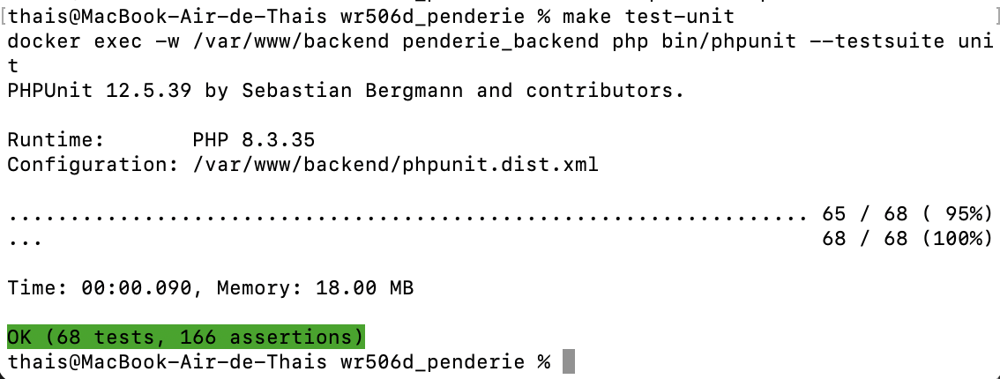
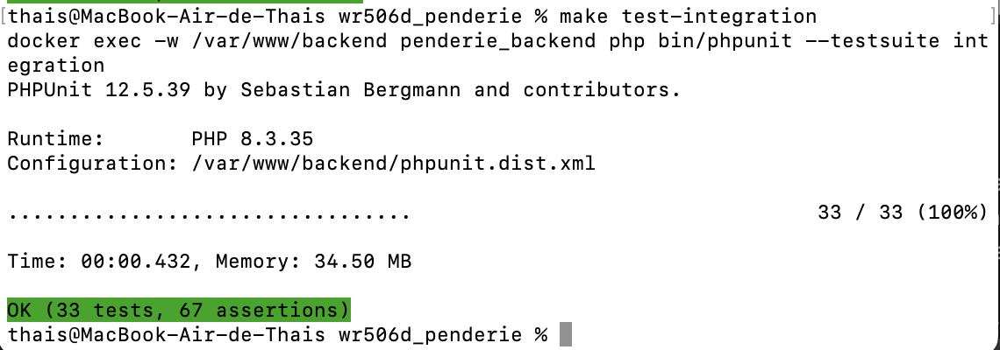
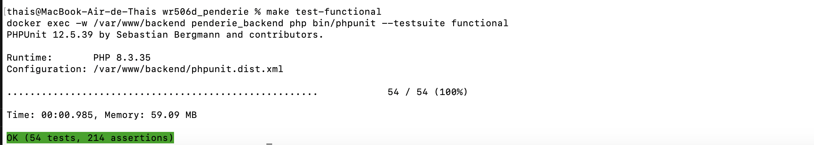
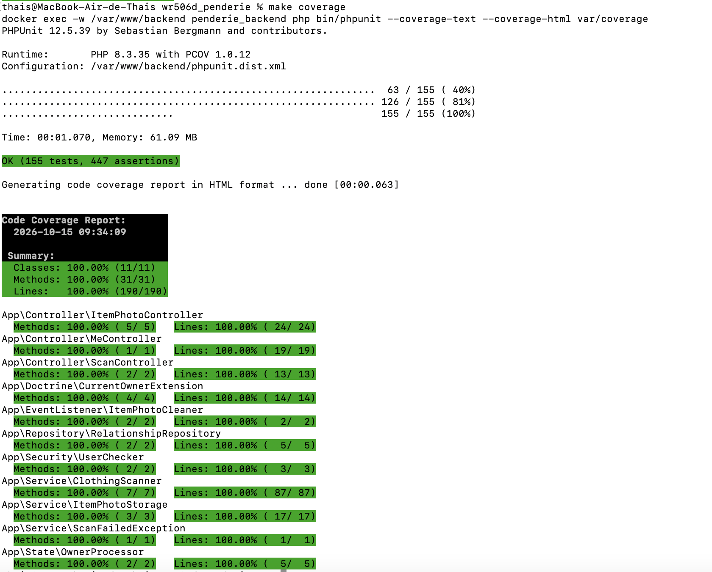
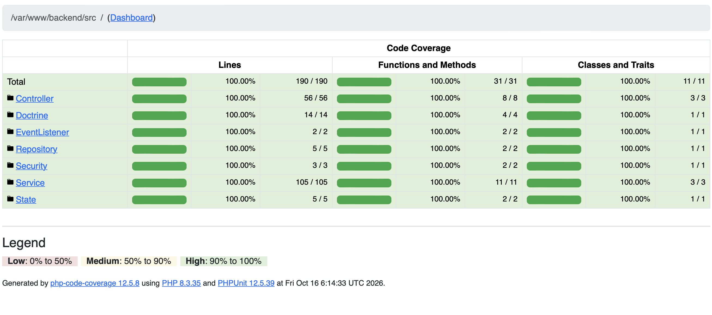
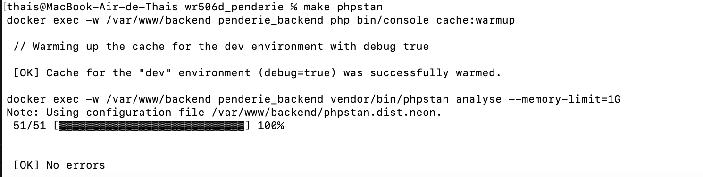
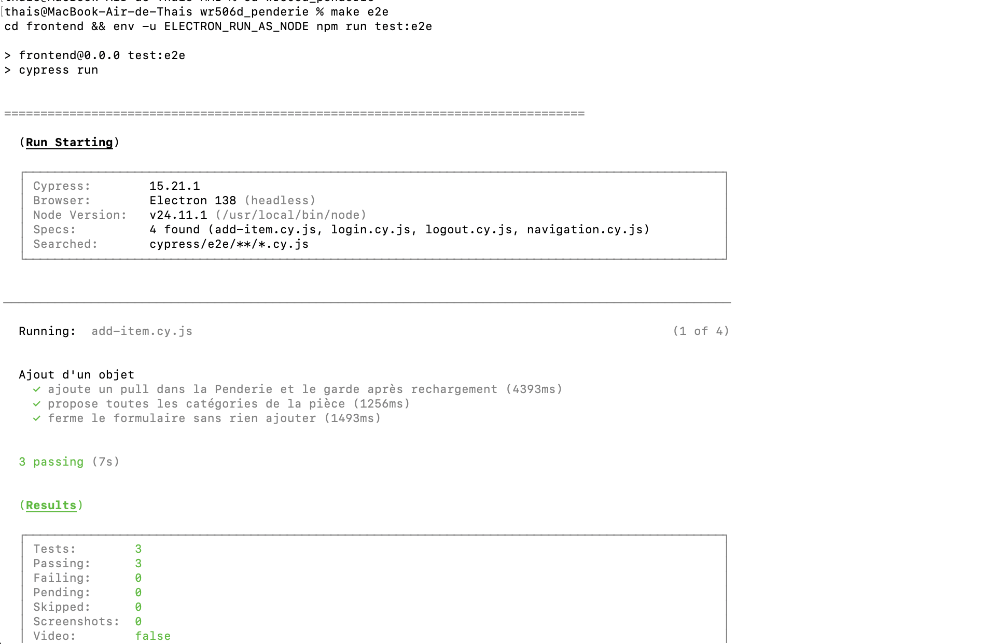
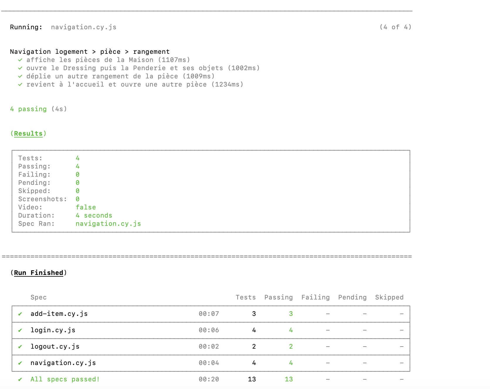
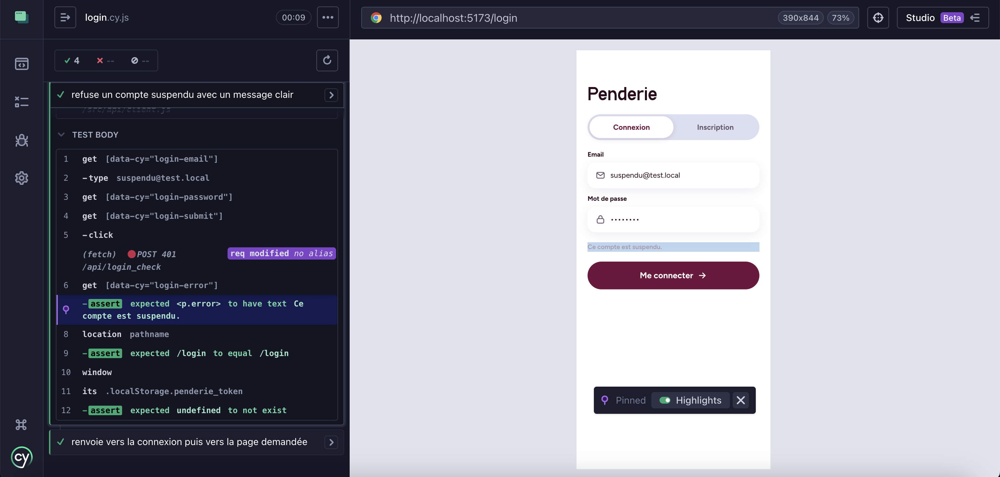

# Contrôles qualité et tests

Toutes les commandes se lancent depuis la racine du dépôt. Le détail de la campagne de test (périmètre, cas testés, limites) est dans [coverage.md](coverage.md).

Les contrôles sont lancés en local : il n'y a pas encore de pipeline d'intégration continue automatisé.

## Commandes

Les commandes PHP s'exécutent dans le conteneur `penderie_backend`. Les tests Cypress s'exécutent sur la machine hôte, depuis `frontend/`.

| Commande | Rôle |
|---|---|
| `make test-db` | (Re)crée la base de test `penderie_db_test` : suppression, création, migrations, fixtures du groupe `test` |
| `make test` | Lance les 155 tests PHPUnit (unit, integration, functional) |
| `make test-unit` | Tests unitaires, sans base de données (68 tests) |
| `make test-integration` | Tests d'intégration sur la base de test (33 tests) |
| `make test-functional` | Tests fonctionnels de l'API (54 tests) |
| `make coverage` | Tests PHPUnit avec la couverture du code métier, en texte et en HTML dans `backend/var/coverage/` |
| `make e2e` | Tests Cypress en ligne de commande (13 tests) |
| `make e2e-open` | Interface Cypress, pour suivre les tests pas à pas |
| `make phpstan` | Analyse statique PHPStan, niveau 6 |
| `make quality` | Linters Symfony (`lint`), PHPStan et audit des dépendances Composer et npm (`audit`) |

Autres cibles utiles : `make fixtures-test` (recharge seulement les fixtures de test) et `make fixtures-dev` (recharge les fixtures du groupe `dev` dans la base de dev). `make help` liste toutes les cibles.

## Captures

### Tests unitaires : `make test-unit`



Les 68 tests unitaires passent en moins d'une seconde : le scanner IA, le stockage des photos, la sécurité et le processor sont testés sans base de données ni réseau.

### Tests d'intégration : `make test-integration`



Les 33 tests d'intégration interrogent la vraie base `penderie_db_test` : compteurs de relations et filtrage du contenu par propriétaire.

### Tests fonctionnels : `make test-functional`



Les 54 tests fonctionnels envoient de vraies requêtes HTTP à l'API. Plusieurs tests d'isolation vérifient qu'une ressource d'un autre utilisateur répond **404** : ces 404 sont attendues. Elles étaient écrites en `[error] Uncaught PHP Exception NotFoundHttpException` dans le terminal. En environnement de test, elles sont désormais écrites dans `backend/var/cache/test/test.log`, et la sortie ne montre plus que le résultat. Un vrai échec de test reste affiché par PHPUnit (`FAILURES!`).

### Couverture : `make coverage`



Les 155 tests passent, et les 11 classes du périmètre métier sont couvertes à 100 % (190 lignes sur 190, 31 méthodes sur 31). La ligne `with PCOV 1.0.12` confirme que la couverture est mesurée par PCOV.



Le rapport HTML (`backend/var/coverage/index.html`) détaille la même couverture par dossier du périmètre (Controller, Doctrine, EventListener, Repository, Security, Service, State) : 100 % des lignes, des méthodes et des classes partout. Depuis chaque dossier, on peut ouvrir le code source et voir les lignes exécutées par les tests.

### Analyse statique : `make phpstan`



PHPStan analyse les 51 fichiers de `backend/src/` au niveau 6, sans aucune erreur.

### Cypress, début de `make e2e`



Cypress 15.21.1 démarre en mode headless (Electron), trouve les 4 specs et joue la première, `add-item.cy.js`, dont les 3 tests passent.

### Cypress, fin de `make e2e`



Le tableau final récapitule les 4 specs : 13 tests sur 13 passent, en une vingtaine de secondes, fixtures rechargées avant chaque test comprises.

### Cypress, mode interactif : `make e2e-open`



Dans l'interface Cypress, chaque étape du test « refuse un compte suspendu » est visible à gauche :
- la requête `POST /api/login_check` répond 401 ;
- le badge `req modified` montre que l'en-tête de test a été ajouté ;
- l'application affiche « Ce compte est suspendu. » dans le cadre mobile de 390 × 844.

## Machine neuve

1. Démarrer les conteneurs : `docker compose up -d`.
2. Générer les clés JWT. Elles ne sont pas versionnées (`backend/config/jwt/*.pem` est ignoré par git) :
   ```bash
   docker exec penderie_backend php bin/console lexik:jwt:generate-keypair --skip-if-exists
   ```
3. Créer la base de test : `make test-db`. À refaire seulement si les migrations ou les fixtures changent.
4. Installer le binaire Cypress pour la machine hôte, depuis `frontend/` :
   ```bash
   cd frontend && npx cypress install
   ```
   **Ne pas lancer `npm install` sur le Mac.** Le dossier `frontend/node_modules` est partagé avec le conteneur Alpine `penderie_frontend`, et une installation depuis macOS y remplacerait les binaires Linux de Vite : le serveur de développement ne démarrerait plus. Les dépendances s'installent dans le conteneur. Pour Cypress, utiliser `CYPRESS_INSTALL_BINARY=0` : le paquet npm est ajouté sans binaire, et le binaire macOS est installé à part par `npx cypress install`.
5. Lancer les contrôles : `make test`, `make coverage`, `make e2e`, `make phpstan`.

### Problèmes connus

- **Cypress ne démarre pas** (`bad option: --no-sandbox`). La variable `ELECTRON_RUN_AS_NODE` est définie, par exemple par une extension VS Code. `make e2e` et `make e2e-open` la retirent. Pour lancer `npm run test:e2e` à la main, le préfixer par `env -u ELECTRON_RUN_AS_NODE`.
- **nginx refuse une configuration valide après une modification de `docker/nginx/default.conf`.** Docker Desktop monte ce fichier seul, et le conteneur peut garder l'ancienne taille du fichier. Lancer `docker compose restart web` plutôt que `nginx -s reload`.

## Limite : l'en-tête de test réservé au Docker local

Pour que les tests Cypress utilisent la base de test sans toucher à la base de dev, nginx transmet `APP_ENV=test` à Symfony quand une requête porte l'en-tête `X-Penderie-Env: test` (voir [docker/nginx/default.conf](docker/nginx/default.conf)). Cypress ajoute cet en-tête à toutes les requêtes de l'application testée. Sans l'en-tête, l'application reste en environnement dev.

⚠️ **Cette configuration est réservée au Docker local et ne doit jamais être utilisée en production.** N'importe quel visiteur pourrait envoyer l'en-tête et faire passer l'application en environnement de test : mode debug, traces d'erreur détaillées, autre base de données. Une configuration nginx de production ne doit pas contenir le bloc `map $http_x_penderie_env` ni la ligne `fastcgi_param APP_ENV`.
